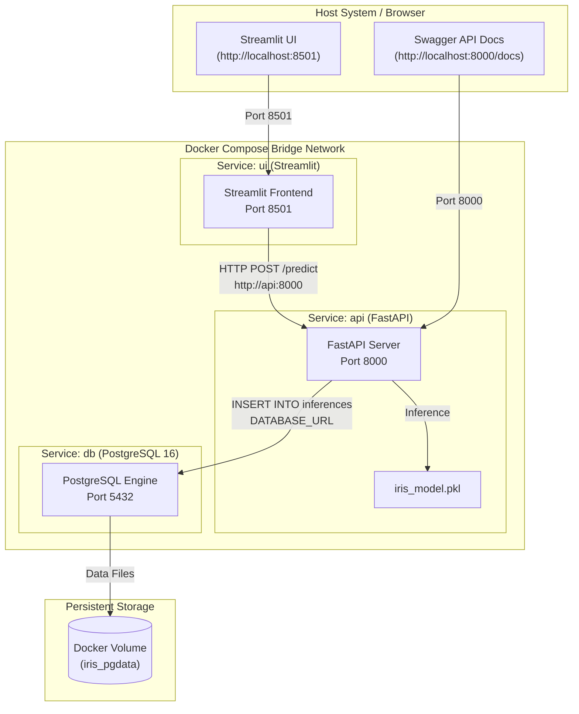

# Iris Full-Stack Classifier 🌸

An end-to-end, containerized Machine Learning full-stack application that classifies Iris flower species based on four morphological measurements. Built with **FastAPI**, **Streamlit**, and **PostgreSQL**, orchestrated seamlessly using **Docker Compose**.

---

## 📑 Table of Contents
- [Overview](#overview)
- [Architecture](#architecture)
- [Project Structure](#project-structure)
- [Technologies Used](#technologies-used)
- [Prerequisites](#prerequisites)
- [Environment Configuration](#environment-configuration)
- [Running with Docker Compose (Recommended)](#running-with-docker-compose-recommended)
- [Running Locally Without Docker](#running-locally-without-docker)
- [API Endpoints & Documentation](#api-endpoints--documentation)
- [Testing & Verification](#testing--verification)
- [Database Verification](#database-verification)
- [Troubleshooting](#troubleshooting)

---

## 🎯 Overview

The application takes 4 flower measurements in centimetres:
1. **Sepal Length (cm)**
2. **Sepal Width (cm)**
3. **Petal Length (cm)**
4. **Petal Width (cm)**

It uses a pre-trained **Logistic Regression** model to predict one of three species:
- **Class 0:** Iris Setosa 🌺
- **Class 1:** Iris Versicolor 🌷
- **Class 2:** Iris Virginica 🪻

Every inference request submitted via the UI or directly via the API is automatically logged to a persistent **PostgreSQL** database with its input features, predicted class ID, and timestamp.

---

## 🏗️ Architecture



---

## 📂 Project Structure

```text
iris-fullstack-classifier/
├── .gitignore               # Git ignore rules (protects credentials and cache)
├── compose.yaml             # Docker Compose specification (api, ui, db services)
├── README.md                # Project documentation and guide
├── api/
│   ├── .env                 # API environment secrets (DATABASE_URL, git-ignored)
│   ├── .env.example         # Template for environment configuration
│   ├── Dockerfile           # Multi-stage/cached Docker build for FastAPI
│   ├── main.py              # FastAPI app, Lifespan DB migration, /predict endpoint
│   ├── README.md            # Dedicated API documentation
│   ├── requirements.txt     # API Python dependencies
│   └── model/
│       └── iris_model.pkl   # Serialized pre-trained Logistic Regression model
├── notebooks/
│   └── Iris_model.ipynb     # Jupyter Notebook used to train the scikit-learn model
└── ui/
    ├── app.py               # Streamlit web application frontend
    ├── Dockerfile           # Docker container recipe for Streamlit
    └── requirements.txt     # UI Python dependencies (streamlit, requests)
```

---

## ⚙️ Technologies Used

- **Backend:** [FastAPI](https://fastapi.tiangolo.com/) (Python 3.11), [Uvicorn](https://www.uvicorn.org/) (ASGI server), [Pydantic v2](https://docs.pydantic.dev/)
- **Machine Learning:** [scikit-learn](https://scikit-learn.org/), [NumPy](https://numpy.org/)
- **Database:** [PostgreSQL 16 Alpine](https://www.postgresql.org/), [psycopg 3](https://www.psycopg.org/psycopg3/)
- **Frontend:** [Streamlit](https://streamlit.io/), [Requests](https://requests.readthedocs.io/)
- **DevOps & Containerization:** [Docker](https://www.docker.com/), [Docker Compose](https://docs.docker.com/compose/)

---

## 📋 Prerequisites

Before running the application, make sure you have:
- **Docker Desktop** installed and running (Windows / macOS / Linux)
- **Git** installed
- *(Optional, for running without Docker)*: **Python 3.11+** installed locally

---

## 🔐 Environment Configuration

Create or verify `api/.env` before starting:

```env
DATABASE_URL=postgresql://postgres:postgres@db:5432/iris
```

> **Security Note:** `api/.env` is ignored by Git in `.gitignore` to prevent committing credentials. For sharing with other developers, use `api/.env.example` as a template.

---

## 🚀 Running with Docker Compose (Recommended)

To build and start all 3 services (`db`, `api`, and `ui`) in one command:

```bash
docker compose up --build
```

To run in detached mode (in the background):

```bash
docker compose up --build -d
```

### Accessing the Services
* **Streamlit Web UI:** [http://localhost:8501](http://localhost:8501)
* **FastAPI Swagger Interactive Docs:** [http://localhost:8000/docs](http://localhost:8000/docs)
* **FastAPI ReDoc Docs:** [http://localhost:8000/redoc](http://localhost:8000/redoc)
* **PostgreSQL:** `localhost:5432` (User: `postgres`, Password: `postgres`, DB: `iris`)

To stop the containers:

```bash
docker compose down
```

To stop and remove containers while preserving database volume data:

```bash
docker compose down
```

*(Note: Data remains preserved inside the Docker volume `iris_pgdata` across restarts).*

---

## 💻 Running Locally Without Docker

If you prefer to run services directly on your host machine:

### 1. Start a local PostgreSQL instance
Create a database named `iris` with user `postgres` and password `postgres`.

### 2. Set up and run the API
```bash
cd api
python -m venv .venv

# On Windows (PowerShell):
.\.venv\Scripts\Activate.ps1
# On Linux/macOS:
source .venv/bin/activate

pip install -r requirements.txt
uvicorn main:app --reload --host 0.0.0.0 --port 8000
```

### 3. Set up and run the UI
In a separate terminal:
```bash
cd ui
python -m venv .venv

# On Windows (PowerShell):
.\.venv\Scripts\Activate.ps1
# On Linux/macOS:
source .venv/bin/activate

pip install -r requirements.txt

# Specify the local API address:
# On Windows (PowerShell):
$env:API_URL="http://localhost:8000"
streamlit run app.py

# On Linux/macOS:
API_URL=http://localhost:8000 streamlit run app.py
```

---

## 🔌 API Endpoints & Documentation

### `POST /predict`
Predicts species from four morphological measurements.

#### Request Schema
```json
{
  "feature_array": [5.1, 3.5, 1.4, 0.2]
}
```

#### Response Schema
```json
{
  "prediction": {
    "class_id ": 0,
    "class_name": "setosa"
  }
}
```

#### Example `curl` / PowerShell Request
```powershell
Invoke-RestMethod `
  -Uri http://localhost:8000/predict `
  -Method Post `
  -ContentType 'application/json' `
  -Body '{"feature_array":[5.1,3.5,1.4,0.2]}'
```

---

## 🧪 Testing & Verification

1. **Verify UI Workflow:**
   - Open [http://localhost:8501](http://localhost:8501)
   - Enter sample values (e.g., Sepal Length: 5.1, Sepal Width: 3.5, Petal Length: 1.4, Petal Width: 0.2)
   - Click **"🔍 Predict Species"**
   - Confirm that **Iris Setosa** is displayed with Class ID 0.
2. **Verify API Docs:**
   - Open [http://localhost:8000/docs](http://localhost:8000/docs)
   - Execute `/predict` with `{"feature_array": [6.3, 3.3, 6.0, 2.5]}`
   - Confirm response returns **Iris Virginica** (Class ID 2).

---

## 🗄️ Database Verification

To inspect logged inference records directly in the running PostgreSQL container:

```bash
docker compose exec db psql -U postgres -d iris -c "SELECT * FROM inferences;"
```

You should see output similar to:
```text
 id |       features        | prediction |          created_at           
----+-----------------------+------------+-------------------------------
  1 | {5.1,3.5,1.4,0.2}     |          0 | 2026-11-27 12:45:00.123456+00
  2 | {6.3,3.3,6.0,2.5}     |          2 | 2026-11-27 12:46:12.654321+00
(2 rows)
```

---

## 🛠️ Troubleshooting

| Issue | Cause | Solution |
|---|---|---|
| `Connection refused` in UI | UI cannot reach API container | Check that `API_URL=http://api:8000` is set in `compose.yaml` (do not use `localhost` inside Compose). |
| `DATABASE_URL` connection error | Database is still initializing | The `compose.yaml` uses `depends_on: db: condition: service_healthy` to wait for PostgreSQL to pass readiness checks before starting `api`. |
| Port 8000 or 8501 already in use | Another local process or previous container is holding the port | Free the port or stop competing containers using `docker ps` and `docker stop <id>`. |
| Predictions work but DB empty | `DATABASE_URL` is missing | Ensure `api/.env` exists and contains `DATABASE_URL=postgresql://postgres:postgres@db:5432/iris`. |
